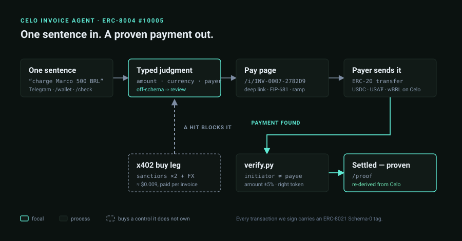
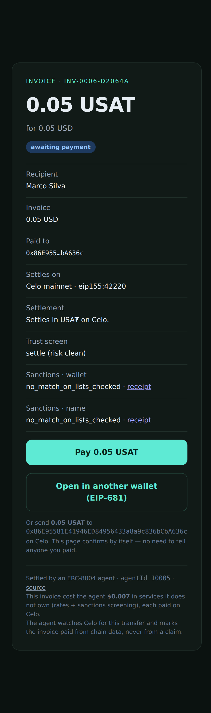
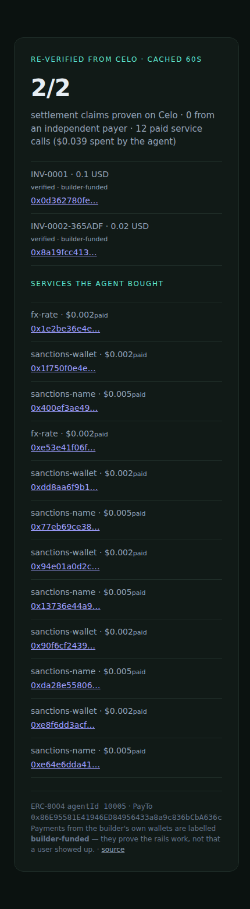

# Celo Invoice Agent

A freelancer types one sentence. The agent prices it, screens it, mints a pay page
anyone can open, watches Celo for the money, and marks the invoice paid **from the
chain rather than from a claim**.

Built for the Celo *Agents on Open Rails* hackathon. Celo mainnet only.

[](https://github.com/memeshee/celo-invoice-agent/actions/workflows/ci.yml)



## Try it — two invoices are open and screened

Nobody has to sign up, install anything, or talk to me. Press pay:

- **[0.05 USDC](https://celo.uconfidant.tech/i/INV-0007-2782D9)** — the token a Celo wallet is most likely to hold
- **[25 wBRL](https://celo.uconfidant.tech/i/INV-0008-9E74F4)** — the LatAm path, with a prefilled Ripio on-ramp if you hold no stablecoin at all

Both pages flip to settled by themselves once the transfer lands — verified from the
chain, no confirm button, nobody to tell.

| | |
|---|---|
| **Bot** | [@notcelordbot](https://t.me/notcelordbot) — `/wallet`, one sentence, done |
| **Onchain proof** | [celo-invoice-agent.vercel.app/proof](https://celo.uconfidant.tech/proof) — re-derives every claim from Celo (cached 60s) |
| **Agent card** | ERC-8004 `agentId 10005` on Celo · [`/agent.json`](https://celo.uconfidant.tech/agent.json) · [8004scan](https://8004scan.io/agents/celo/10005) |
| **Judging map** | [docs/judging.md](docs/judging.md) — each criterion → the code that satisfies it |



## What one invoice costs the agent, and why

The agent owns neither a sanctions list nor an FX feed, so it **buys them per invoice**
over x402 on Celo — and those purchases decide whether money may move.

| Bought | Price | What it decides |
|---|---|---|
| `sanctions-wallet` | $0.002 | Is the payout wallet on a watchlist? |
| `sanctions-name` | $0.005 | Is the counterparty name on one? |
| `fx-rate` | $0.002 | Cross-check on non-USD pricing |

A non-clean verdict sets the invoice to `blocked` and takes it out of the settlement
queue. Every purchase is captured to [`docs/receipts/`](docs/receipts) before it is
parsed, and its settlement is re-checked onchain afterwards.

## Why the money cannot move on a bad invoice

Each of these is enforced in code and has a test that fails without it:

- **Parsing fails closed.** Model answers are validated against the candidates we
  offered; off-schema becomes `review`, never `settle`. A held invoice renders a
  refusal and no pay button.
- **One definition of "was this paid".** `bot/verify.py` requires the transaction to
  exist, succeed, *not be initiated by the payee*, carry the right token to the right
  address, and match the amount within 5% — "at least this much" is not a payment. The
  watcher and the manual `/check` both ask it.
- **Statuses are refusals, not labels.** `mark_settled` accepts only `open`, so a
  held, blocked, dropped or expired invoice cannot be settled by any path.
- **A failed screen is not a clearance.** Screening must be `done`; a crashed purchase
  is retried, and until it succeeds the invoice waits instead of settling unscreened.
- **One transfer settles one invoice.** A consumed-witness registry blocks replay.
- **The agent cannot overspend itself.** Aggregate and per-host x402 budgets with an
  issued-authorization ledger, and the signed authorization window is clamped whatever
  a peer asks for.

## Onchain activity you can check

All real Celo mainnet transactions. `scripts/verify_settlements.py` re-derives the
settlements, and a daily CI workflow runs it so none of this can quietly rot.

| What | Transaction |
|---|---|
| ERC-8004 identity registered (`agentId 10005`) | [`0x9c101fb0…2b70`](https://celoscan.io/tx/0x9c101fb0dcbfeba0d95c0172b22c996bec949a4d908b4daeaf486c0cd12b2b70) |
| Agent card declares its live endpoint — then corrected three times: it had claimed invoices settle *over the x402 facilitator*, it advertised `x402Support: true` though we only *pay* over x402, and it pointed at a rotating host | [`0xa9416d84…`](https://celoscan.io/tx/0xa9416d841b049e3546bab955cff3388ef2b160b9f468f28342da557bea9b1e64) · [`0xdcd801a4…`](https://celoscan.io/tx/0xdcd801a45f54957a016047b8cd9fe7e1470dc4a9113804b14a97bd5e01eadec1) · [`0xdb1a214f…`](https://celoscan.io/tx/0xdb1a214f29df4452a38fea0d45c1df2babbaba2c57633a4c550faf3b459584a1) · [`0x0374549a…`](https://celoscan.io/tx/0x0374549a1719384ef622cd5529435648e99e45f9aad3f18d59d61d1808d44b67) |
| Invoice paid 0.1 USA₮ → settled autonomously, no human | [`0x0d362780…8929`](https://celoscan.io/tx/0x0d362780feaa31c632f3ead6b09d55ab9bcc53d5c5c649520d3fa668d6648929) |
| Invoice paid 0.02 USA₮ → settled autonomously | [`0x8a19fcc4…c724c4`](https://celoscan.io/tx/0x8a19fcc4139524502b52cc25748b9a40bee64384d09986b8f809690b77c724c4) |
| **Withdrawn claim:** 0.998543 USA₮ arrived via a Squid bridge for a 0.1 USD invoice; the verifier now refuses it as an amount mismatch | [`0xe5796183…1073ee`](https://celoscan.io/tx/0xe5796183431382dd8e2e543b11140497420c8bb09cc35f5a24a52e76d731073e) |
| Agent buys an FX rate — $0.002 | [`0x1e2be36e…c51b4`](https://celoscan.io/tx/0x1e2be36e4eceb26a1908ccd1decbf35d29a5f411ab5dcf00c269e7fdad0c51b4) |
| Agent buys a wallet sanctions screen — $0.002 | [`0x1f750f0e…ebad5b`](https://celoscan.io/tx/0x1f750f0e4ef3e5db04fbf3b5fbef8a67ecda043df5604ace31ffd2db72ebad5b) |
| Agent buys a name sanctions screen — $0.005 | [`0x400ef3ae…2984dd`](https://celoscan.io/tx/0x400ef3ae497217f697fb6f151002085199ea726844d7382282567e38572984dd) |
| Textile FX: 1 USDT → 5.006 wBRL, swapped **into the agent wallet** (payout leg not wired) | [`0xcac8b05d…2eec9e0`](https://celoscan.io/tx/0xcac8b05db8899954f2e5a920d842ebca448d8e5ebc2eadc6c4096e0392eec9e0) |



`/proof` is not a dashboard: it re-runs `bot/verify.payment_proof` over every settled
invoice (cached 60s, and the page says so), so the numbers are re-derived from Celo
rather than read back out of our own store. Each payment is labelled `independent
payer`, `builder-funded` or `unverified` from an allowlist of our own wallets.

**It reads 0 independent payers today.** Every settlement came from a wallet we
control. The rails work end to end; the users are still ours.

## Deployed addresses

| Thing | Celo mainnet |
|---|---|
| ERC-8004 Identity Registry | [`0x8004A169FB4a3325136EB29fA0ceB6D2e539a432`](https://celoscan.io/address/0x8004A169FB4a3325136EB29fA0ceB6D2e539a432) |
| Agent identity | `agentId 10005`, owned by `0xDbFe5c4d0256D2459bB216caB905999Ca41bE349` |
| USA₮ · USDC · USDT | `0xD2ab3C9A02DBBAB236BfEC45D1d755DF4267F771` · `0xcEBA9300f2b948710d2653dD7B07f33A8B32118C` · `0x48065fbBE25f71C9282ddf5e1cD6D6A887483D5e` |
| wBRL · wARS · wCOP (Ripio wFIAT, 18 dec) | `0xD76f5Faf6888e24D9F04Bf92a0c8B921FE4390e0` · `0x0DC4F92879B7670e5f4e4e6e3c801D229129D90D` · `0x8a1D45e102e886510e891d2Ec656a708991e2D76` |
| x402 facilitator (outbound only — we buy services; the asset table is pinned in `bot/x402.py` and re-checked by tests) | `https://api.x402.celo.org` |
| **PayTo wallet** (x402 payments carry no ERC-8021 tag yet, so it is published here) | `0x86E95581E41946ED84956433a8a9c836bCbA636c` |

## Run it

```bash
python3 -m venv .venv && source .venv/bin/activate
pip install -r requirements-dev.txt
cp .env.example .env      # TELEGRAM_BOT_TOKEN, AGENT_WALLET_KEY, INVOICE_WALLET
python -m bot.main        # Telegram bot
python -m bot.serve       # public invoice pages on PUBLIC_PORT
python -m bot.watch       # settlement watcher + the per-invoice purchases
```

`deploy/*.service` are the systemd units this runs under (each `Restart=always`).

**Hosting, stated plainly.** The app runs on a home machine. A Cloudflare quick tunnel
gives it an origin; Vercel serves a static landing page and reverse-proxies only the
dynamic paths (`/i/*`, `/proof`, `/api/*`, `/agent.json`) to that origin — so the URL a
judge holds stays valid even when the tunnel hostname rotates.
`scripts/tunnel_sync.sh` republishes the proxy on every rotation and
`scripts/set_agent_services.py` rewrites the ERC-8004 card to match, because an
advertised endpoint that stops answering is worse than no advertisement.

```bash
python scripts/verify_settlements.py         # exit != 0 if any claim fails
python scripts/verify_settlements.py --fix   # withdraw the ones that do not hold
bash scripts/publish_site.sh                 # rebuild + redeploy the public host
```

## Tests

```bash
python -m pytest            # 222 tests, offline: no network, no keys, no .env
python -m pytest -m network # live facilitator, Textile, agent402, Typesafe Jev
python -m pytest -m live    # reads real Celo mainnet history
ruff check .                # lint (E, F, W, I, B)
```

The default run passes on a clean checkout with nothing configured: network- and
key-dependent tests are marked and excluded by `pytest.ini`. CI runs exactly that, plus
ruff, byte-compilation, a 75% coverage floor (currently 78%) and an advisory dependency
audit. The densest tests are where silence costs money — every refusal path in
`bot/verify.py`, the x402 spend budgets, the screening gate, and the public HTTP surface
over a real socket.

## Tracks this targets

- **Stable Agents: LatAm** — `/wallet <addr> wBRL` and a BRL invoice settles **500 wBRL
  for 500 BRL**: in kind, no FX, no dollar in the middle. The pay page carries a
  prefilled Ripio on-ramp bound to the payout address, so a payer who has never held a
  stablecoin can still pay.
- **Open Corridors: USA₮ over x402** — settlement is proven per transaction from the
  chain, and the asset is chosen per freelancer rather than globally. **Every payment so
  far is builder-funded**; an outside payer is the remaining gap, and `/proof` says so
  on the page.
- **Build with `buy`** — every invoice costs the agent ~$0.009 in services it does not
  own, and a sanctions hit blocks settlement rather than decorating it.

## Limits (stated, not hidden)

- Non-USD fiat is priced by a keyless rate API and *cross-checked* against a rate the
  agent buys; it is not a firm market quote.
- Textile is wired as a standalone FX swap with committed receipts, not yet as an
  automatic payout leg.
- Invoice storage is a JSON file with one writer. Fine at demo scale, not multi-tenant
  safe.
- x402 payments carry no ERC-8021 tag (facilitator limitation) — hence the published
  PayTo wallet. Everything else we send is tagged.
- The sanctions screen is a screen: the vendor's own receipt calls its verdict "not a
  clearance".
- Two claims in this repo did not survive its own verifier; both are still listed above
  with the transaction and the reason. That is what the verifier is for.
